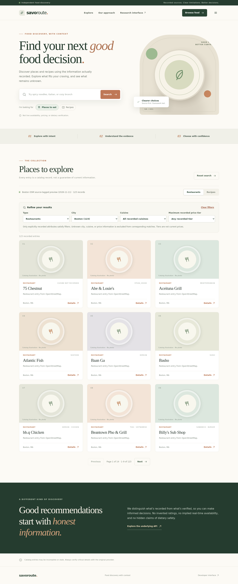
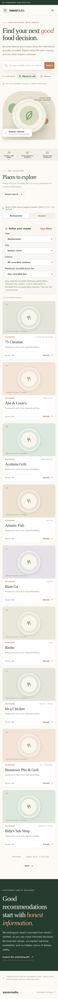

# SavoRoute

**Explore actual source-tagged restaurant records, see the evidence, and search without invented ratings.**

SavoRoute combines a mobile-friendly React discovery interface, a Python/FastAPI
backend, and read-only local MCP tools. A separate OSM-backed Boston preview
provides real historical restaurant records; the default installation remains
fictional for reproducible development and does not claim verified availability.

### Real application screenshots

<!-- SCREENSHOTS_BEGIN -->
These screenshots were captured from the **running React consumer app**
using the opt-in November 2026 OSM Boston catalog. Real source-tagged records,
not a live verification of restaurant availability.

| React desktop | React mobile |
| --- | --- |
|  |  |
<!-- SCREENSHOTS_END -->

### Try real Boston restaurant data

With Python 3.11+ and Node.js 22.12+ from a checked-out repository:

```bash
python -m pip install -e ".[api]"
(cd webapp && npm ci && npm run build)
savoroute web serve --catalog data/real/boston-osm-2026-11.json --host 127.0.0.1 --port 8000
```

Open **http://127.0.0.1:8000/app/** for the React consumer interface.
The preview includes **123** named OSM restaurant records with an explicit
Boston city tag; one private listing and 41 records without that tag were
excluded. It is a snapshot, **not current restaurant verification**.
See [data rights and provenance](data/real/README.md) (ODbL-1.0).

To produce **current, real React screenshots** after installing Playwright Chromium:

```bash
(cd webapp && npx playwright install chromium && npm run screenshots)
```

This produces `docs/screenshots/consumer-desktop-real.png` and
`docs/screenshots/consumer-mobile-real.png`, captured by loading the running
React app against the real catalog. **After both images succeed, the script
updates the README screenshot links automatically.** Review the images and
README diff, then commit both generated PNGs and the README change.

**Photo understanding:** not currently implemented in the standalone web app.
See [the first-product plan](docs/first-product-and-ai.md). The existing MCP
server exposes catalog search to compatible local AI hosts; it does not itself
interpret camera images or connect automatically to all commercial chat apps.


SavoRoute is an experimental Python application for searching and comparing restaurant and recipe records. It provides a browser interface, a versioned read-only HTTP API, command-line tools, and six read-only tools for local MCP clients. All interfaces reuse the same catalog and retrieval services.

**Project status:** developer preview (`0.22.0`). This is not a live restaurant directory or a production agent. The default catalog is fictional. Restaurant opening hours, menu availability, current prices, allergen safety, and reservations are **not verified**. There are no autonomous agent workflows or user accounts.

## Try the application

Requires Python 3.11 or newer.

```bash
python -m venv .venv
source .venv/bin/activate     # Windows PowerShell: .venv\Scripts\Activate.ps1
python -m pip install -e ".[api]"
savoroute web serve --host 127.0.0.1 --port 8000
```

Open <http://127.0.0.1:8000/>. The default demo uses packaged fictional restaurant and recipe records; no credentials, model download, GPU, or external services are needed. API documentation is at <http://127.0.0.1:8000/docs>.

```bash
savoroute search "spicy tofu noodles" --kind recipe
savoroute recommend "spicy tofu" --kind recipe --json
savoroute --help
```

## Consumer web preview (PR 2: search and discovery)

A separately built React/TypeScript interface is available at `/app/` after
running the frontend build. The existing `/` browser app and all read-only
API, CLI and MCP interfaces remain available throughout the migration.

Requires Python 3.11+ and Node.js >=22.12:

```bash
python -m pip install -e ".[api]"
(cd webapp && npm ci && npm run build)
savoroute web serve --host 127.0.0.1 --port 8000
```

Open <http://127.0.0.1:8000/app/>. For live Vite development, start FastAPI
on port 8000 and run `cd webapp && npm run dev` in another terminal; open
<http://127.0.0.1:5173/app/>. See [consumer web foundation](docs/product-web-foundation.md)
for the original shell, and [consumer discovery](docs/consumer-search-discovery.md)
for URL-backed searches, source-recorded filters, result limits, security boundaries,
and browser checks. The consumer app remains a developer preview and uses fictional
demo records by default.

## Implemented capabilities

| Area | Behavior |
| --- | --- |
| Search | Reusable catalog-bound lexical index (overlap and BM25), catalog browsing, and explicit metadata constraints |
| Retrieval | Optional cosine-based text/image indices; item-level reciprocal-rank fusion; SQLite and optional FAISS backends |
| Decisions | Deterministic, catalog-grounded recommendations and comparison of up to three results in the browser |
| Geography | Source-tagged city filtering; optional nearby search from a matching saved OSM snapshot; offline municipality-boundary workflow |
| Evidence | Source identity, provenance records, manually reviewed menu/media references, and optional OSM observation and recipe-note sidecars |
| Evaluation | Fictional fixtures, frozen OSM study inputs, independent relevance labeling, query-level paired bootstrap intervals, and error analysis |
| Privacy | Optional local, user-confirmed visit suggestions from explicitly selected metadata; no automatic photo-library scan |
| Interfaces | Python library, CLI, local browser, read-only FastAPI v1, and six read-only MCP tools over stdio |

Scores are **not probabilities**. Model-backed embeddings and FAISS require optional dependencies and compatible, locally configured indices. The default experience does not invoke an LLM. MCP exposes fixed search/retrieval tools to a trusted host; it does not implement an autonomous decision agent or remote MCP service.

## Real-data pilot (optional, local)

The separate Boston pilot contains 165 saved OSM restaurant records. Of these, **124 have an explicit Boston city tag; 41 have no verified municipality**. The catalog has no reviewed restaurant photographs, current menus, price tiers, or informative reviewed venue descriptions. A separate import adds three source-attributed Wikibooks recipe adaptations, **not independently checked** for culinary accuracy or dietary safety.

**The pilot artifacts are not included in Git-tracked source.** `data/generated/` is ignored by Git. They are included in the separately distributed development ZIP, or can be generated from authorized local inputs using the workflows in [recipe curation](docs/recipe-curation-m4.md), [source quality](docs/data-quality-and-source-facts.md), and [geographic normalization](docs/geographic-normalization.md). A fresh GitHub clone runs the fictional demo unless you supply your own data.

With the separately provided v0.21.0 pilot artifacts present:

```bash
savoroute web serve \
  --catalog data/generated/real-pilot/catalog-with-recipes-v1.json \
  --source-facts data/generated/real-pilot/osm-facts-with-recipes-v1.json \
  --recipe-notes data/generated/real-pilot/recipe-notes-v1.json \
  --port 8001
```

The catalog, OSM observations, and recipe notes are tied to specific input digests; **do not mix outputs from different catalog revisions**. The Boston municipal boundary has not been retrieved and applied to the 41 unknown-city records. See [the audited boundary workflow](docs/boston-boundary-workflow.md).

## Development checks

An opt-in [local retrieval latency benchmark](docs/lexical-index-and-performance.md) compares per-query index construction with reuse of one in-memory index. It is a microbenchmark, **not** an independently judged relevance result or production latency service-level objective.

```bash
python -m pip install -e ".[api,dev]"
python -m pytest -q
python -m ruff check src tests scripts
node --test tests/web/*.test.mjs       # Requires Node.js 22 or newer
```

CI also installs optional MCP/notebook dependencies and executes all notebooks on Python 3.11–3.13. See [contribution guidance](CONTRIBUTING.md) and [release checklist](docs/release-checklist.md). Tests validate implementation behavior; they do **not** establish production security, verified venue data, or independently measured real-world recommendation quality.

## Documentation

- [Architecture](docs/architecture.md) · [Data contract](docs/data-contract.md) · [Web application](docs/web-app.md) · [HTTP API](docs/http-api.md) · [Local MCP](docs/mcp-server.md)
- [Opt-in visits](docs/opt-in-visit-discovery.md) · [Reviewed media and nearby search](docs/geography-and-reviewed-media.md) · [Real-data statistical evaluation](docs/statistical-relevance-study.md)
- [Source quality and rights](docs/data-quality-and-source-facts.md) · [Recipes](docs/recipe-curation-m4.md) · [Geography](docs/boston-boundary-workflow.md)
- [Lexical performance and parity](docs/lexical-index-and-performance.md) · [Retrieval evaluation](docs/evaluation.md) · [Independent relevance review](docs/statistical-relevance-study.md) · [Notebooks](notebooks/README.md)
- [Roadmap](docs/roadmap.md) · [Changelog](CHANGELOG.md)

## Licensing and data use

Original application code and project-authored documentation are licensed under [MIT](LICENSE). **Third-party material is not covered by that grant.** OSM-derived data is subject to [ODbL](https://opendatacommons.org/licenses/odbl/); the three Wikibooks recipe adaptations are identified as [CC BY-SA 4.0](https://creativecommons.org/licenses/by-sa/4.0/) material with source links and notices. Redistribution, modification, attribution, and commercial-use obligations depend on the particular source. The importer cannot establish factual accuracy or legal rights. No third-party recipe photographs are distributed.

For now SavoRoute is a research and engineering prototype; commercial deployment requires an independent data-rights review, source freshness checks, user testing, operational security, and demonstrated usefulness.
